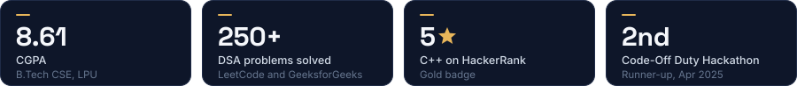

  

  &nbsp;
  &nbsp;
  &nbsp;
  &nbsp;
  

## About me

I'm a final-year Computer Science student at Lovely Professional University, graduating in May 2027. I mostly build backend systems: REST and real-time APIs, event-driven pipelines, and the deployment and monitoring around them.

Recently that has meant an incident-response copilot for Kubernetes, a canary-release platform that rolls itself back, and a fault-localization engine for a simulated power grid. I'm looking for **SDE internships and 2027 new-grad roles** in backend, full-stack or cloud engineering.

## Featured projects

OpsPilot turns Alertmanager alerts into incidents and has a Gemini agent investigate them through read-only tools over Prometheus, Loki, Tempo and the Kubernetes API. It proposes one fix (roll back, restart or scale), changes nothing until a person approves, then verifies the fix against metrics for three minutes and drafts the postmortem.

- Every root-cause claim cites the exact query and result behind it
- Runbooks and past incidents are embedded locally and retrieved with MongoDB Atlas Vector Search
- Fixes run as a service account that can only patch Deployments in one namespace, and every step lands in a hash-chained audit log
- Runs on a k3s cluster behind Traefik; the React console streams the investigation live over Server-Sent Events

[**View code →**](https://github.com/satvikchauhan01/OpsPilot)

 

<table>
<tr>
<td width="50%" valign="top">

Rolls a feature out to 5, 10, 25, 50 and then 100% of users. A guardian checks the canary's error rate in Prometheus every 5 seconds and rolls the flag back to 0% after consecutive breaches.

- Deterministic bucketing: `sha256(flag:salt:user) mod 10000`
- PostgreSQL as the source of truth; Redis for cache, pub/sub and exposure counts
- Hackathon project: **I built the Go backend**; a teammate built the dashboard and demo shop

[**View code →**](https://github.com/satvikchauhan01/CanaryShield)

</td>
<td width="50%" valign="top">

Ingests pole-level telemetry from a simulated grid of about 4,000 poles and localizes each outage to the failed span, transformer or feeder, with a confidence level.

- The API writes to a PostgreSQL inbox and returns 202; a worker claims rows with `FOR UPDATE SKIP LOCKED`
- One ticket per outage; restoration is verified from telemetry
- Ingestion benchmarked at 500 req/s sustained on local Docker

[**View code →**](https://github.com/satvikchauhan01/Fault_Localization_Engine)

</td>
</tr>
<tr>
<td width="50%" valign="top">

A MERN reading platform with friends, a live activity feed and 1:1 chat over Socket.IO, Gemini summaries and RAG over a PIN-locked diary, and Razorpay subscriptions.

- Refresh tokens rotate on every use; replaying a revoked one revokes the whole token family
- Razorpay webhooks are verified on the raw body and deduplicated by event ID
- Vitest, Supertest and Playwright in GitHub Actions; deployed on Vercel and Render, and has also run on AWS (EC2, S3)

[**Live demo →**](https://personal-library-tracker-lac.vercel.app) &nbsp;·&nbsp; [**View code →**](https://github.com/satvikchauhan01/PersonalLibraryTracker)

</td>
<td width="50%" valign="top">

Paste a long URL, get a short link and a QR code. Signed-in users get custom aliases, expiry dates and click stats by day, country, referrer and device.

- A Cloudflare Worker (Hono) serves the API and the redirects; D1 stores links and clicks
- The 302 goes out first and the click is recorded afterwards with `ctx.waitUntil()`
- 171 Worker tests and 36 UI tests run in GitHub Actions on every push

[**Live demo →**](https://hop-frontend.pages.dev) &nbsp;·&nbsp; [**View code →**](https://github.com/satvikchauhan01/Serverless-URL-Shortener)

</td>
</tr>
</table>

### Also built

| Project | What it is | Stack |
| --- | --- | --- |
| [**CardioLens**](https://github.com/satvikchauhan01/CardioLens) | Solo entry, Multimodal AI Hackathon 2026 (IIT Mandi). Four models estimate coronary artery disease risk and narrowing in each of three arteries, shown on an interactive 3D heart with SHAP explanations. | FastAPI, scikit-learn, SHAP, React, TypeScript, three.js |
| [**ConsentGuard**](https://github.com/satvikchauhan01/Consent_Guard) | Final-year project, in progress. A consent and permission management service with purpose-based consent, policy versioning, a consent-check API for client apps, and an audit trail. | TypeScript, Node.js, MongoDB |

## Tech stack

## Get in touch

The quickest way to reach me is **[satvikc4344@gmail.com](mailto:satvikc4344@gmail.com)**. My [resume](https://satvikchauhan01.github.io/Portfolio/satvik-jp.pdf) and [portfolio](https://satvikchauhan01.github.io/Portfolio/) have more detail on each project.
